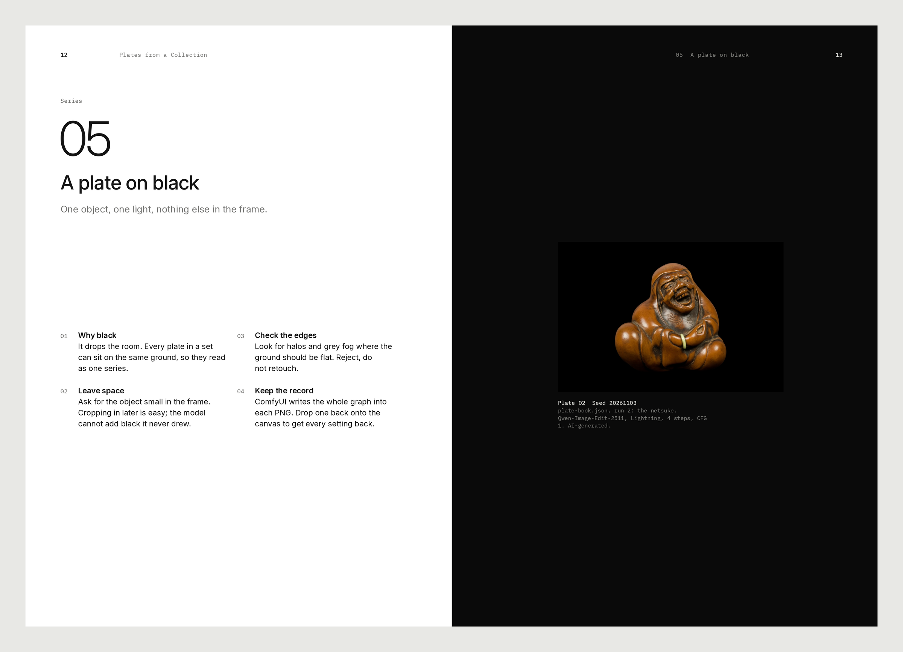
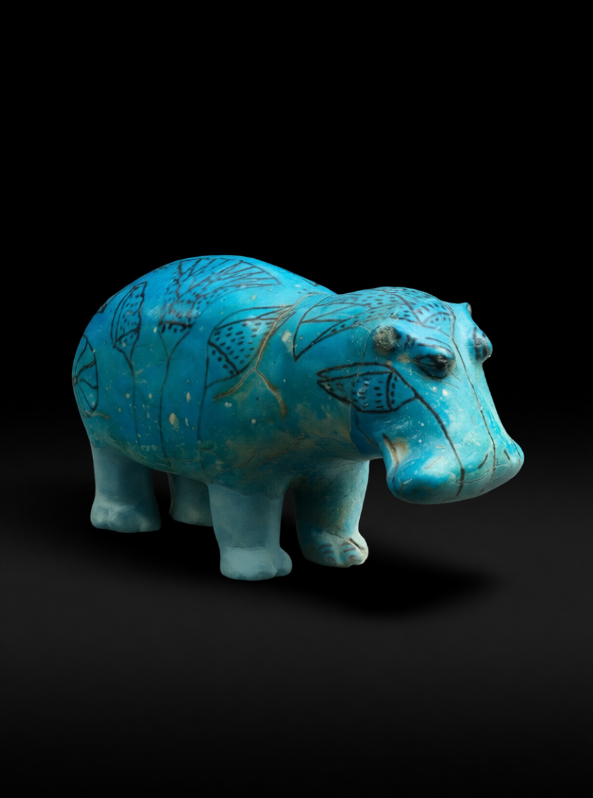
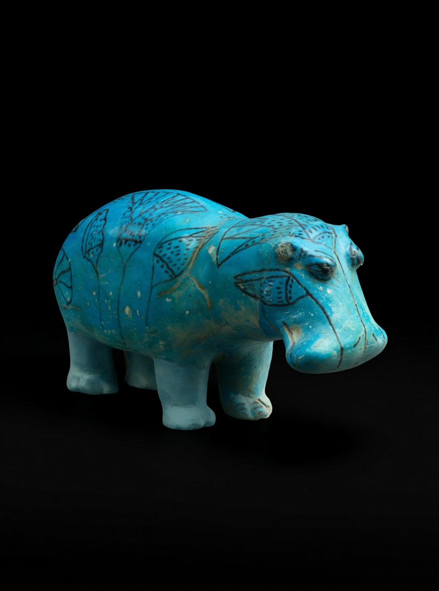
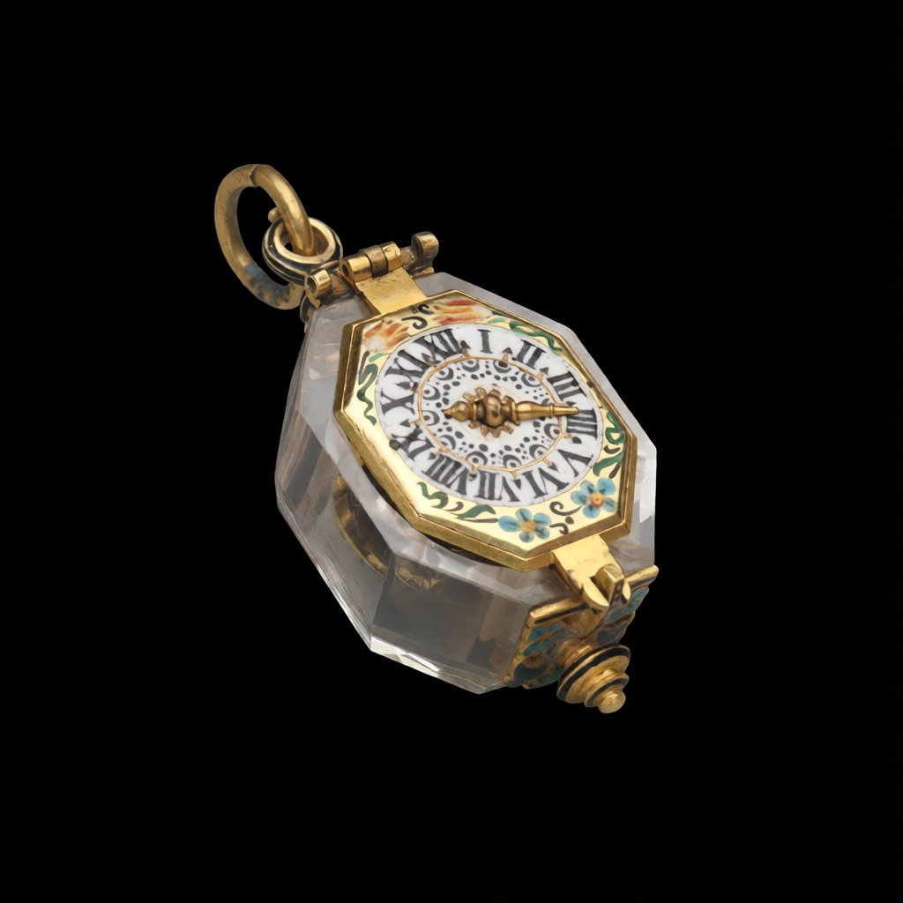
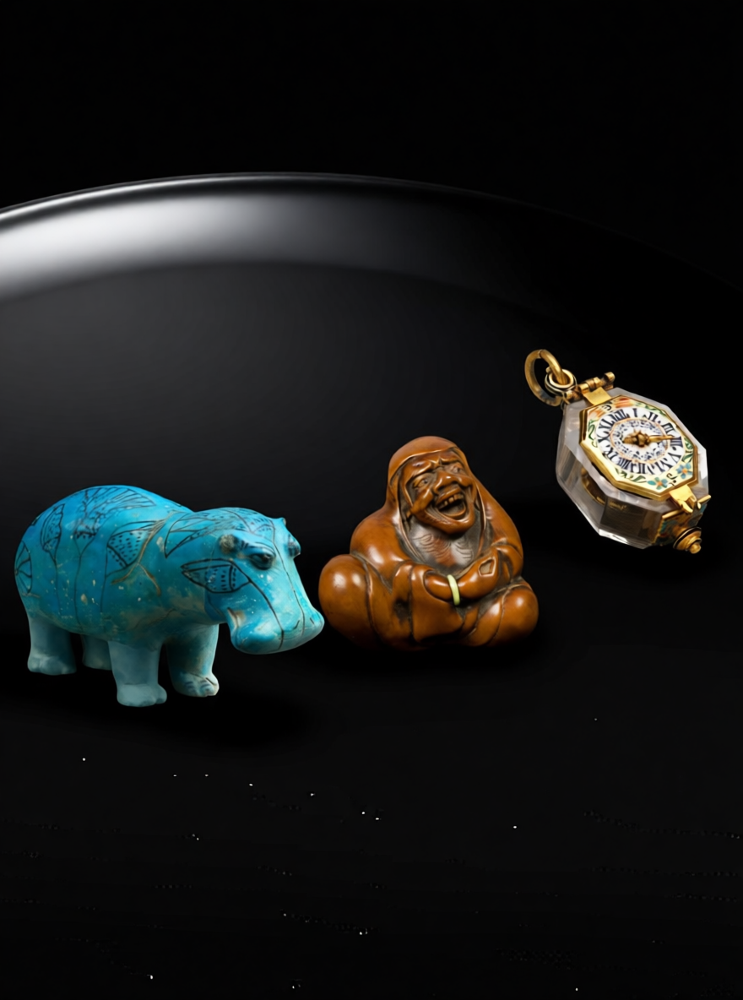
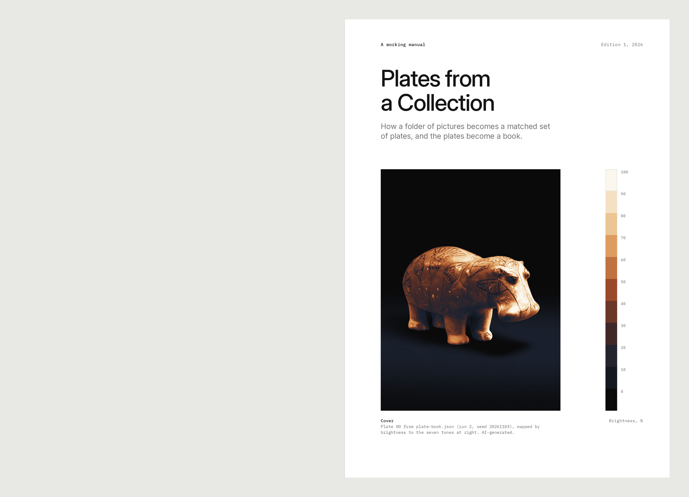
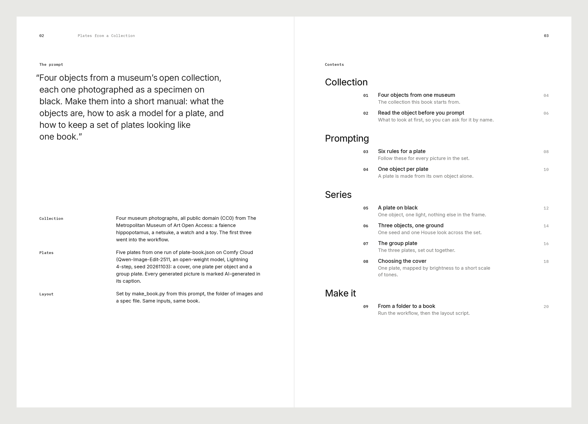
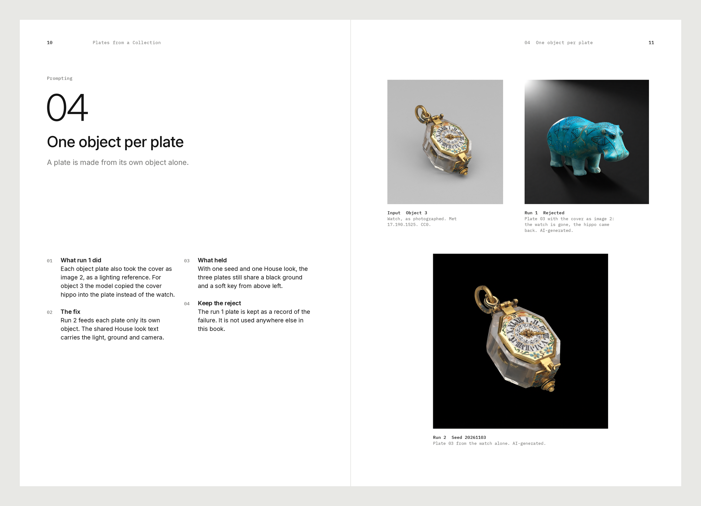
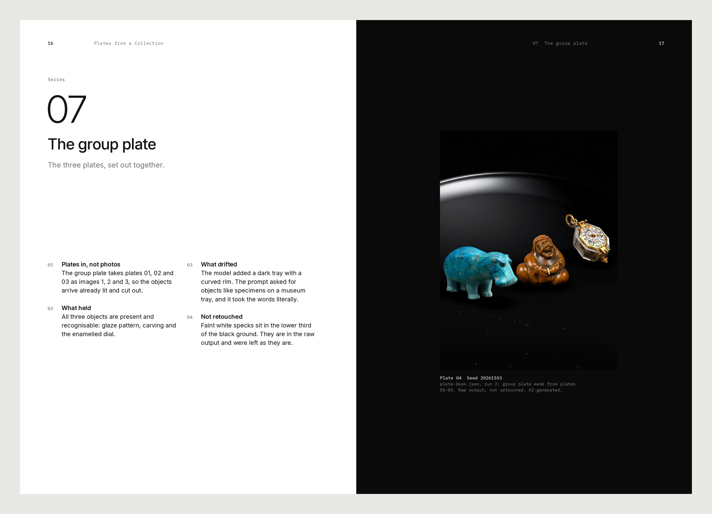

# Plate Book

> A prompt and a folder of pictures in, a printed manual out: numbered chapters, specimen plates on black, a cover mapped to a tone scale.

An entry for Comfy's [Open Source Higgsfield](https://comfy.org/open-source-higgsfield) competition. Open weights, core ComfyUI nodes only, no closed APIs. Repo licensed Apache-2.0 (the LTX-2.3 / Gemma weights used for the optional video are not; see Model licenses).



## What it does

The Higgsfield one-tap preset, aimed at a book instead of a clip. You bring a short prompt (what the book is about)
and a collection (a folder of object photos). You get back a laid-out, numbered manual as a PDF plus PNG spreads.

1. **Plates** (`workflows/plate-book.json`): Qwen-Image-Edit-2511 turns the collection into a matched set of
   photoreal specimen plates on black, in one run:
   - `00_cover`: object 1, small and centred on black, with room above it.
   - `01`–`03`: one plate per object. Each is made from its own object alone; the shared "House look" text keeps light, ground and camera consistent. (A first version also fed the cover in as a lighting reference, but the model then copied the cover object into plate 03, so that link was removed.)
   - `04_group`: the three plates together on one black ground.

   Every plate prompt is `plate instruction + House look + Book prompt`, joined with core `Concatenate` nodes, so you
   edit the look once and the whole book follows. The model never draws type.
2. **Layout** (`scripts/make_book.py`): sets the book with Pillow from a title, the prompt, the image folder and
   optional captions. Deterministic: same inputs, same PDF and PNGs, byte for byte.
   - Cover: the cover plate converted to grey and gradient-mapped onto a tone scale, with the scale printed beside it
     as stepped chips labelled by brightness.
   - Page 2: the prompt, set large. Page 3: contents grouped into sections, with page numbers.
   - One spread per chapter: section label, chapter number (01, 02 …), title, a one-line dek, short numbered notes;
     images with small mono captions (`Plate 02  Seed 20261103`). Chapters can be `grid`, a single `plate` on a
     black page, or `text` (rules set large across the spread).
   - Running header with page number and book title; colophon; end plate.
   - Page 170 × 240 mm, six-column grid, 300 dpi, Inter + IBM Plex Mono (both OFL, bundled in `fonts/`).
3. **Camera move, optional** (`workflows/plate-book-video.json`): the Higgsfield-style "camera move" preset, done with
   open weights. LTX-2.3 image-to-video with audio (official Comfy-Org template) takes the group plate as its first
   frame and makes a slow slider shot along the three objects (8 s, 704x960, 25 fps, seed `20261103`). No closed APIs,
   no partner nodes.

**Run status (2026-11-03 ET):**
- `workflows/plate-book.json` has been run on Comfy Cloud on 2026-11-03 with the settings it ships with:
  `qwen_image_edit_2511_fp8mixed`, Lightning 4-step LoRA on (4 steps, CFG 1, euler / simple), seed `20261103`
  fixed for every plate. Inputs: the three Met Museum open-access (CC0) photos in `examples/images/`
  (`met_01_hippo.png`, `met_02_netsuke.png`, `met_03_watch.png`). The five raw outputs of that run (run 2) are in
  `examples/outputs/run2/`, unedited, with the ComfyUI graph still embedded in each PNG.
- Run 1 (same day, earlier graph that fed the cover into each object plate) put the hippo into plate 03 instead of
  the watch. That graph was fixed (see step 1 above) and run again. The two run 1 plates that failed are kept in
  `examples/outputs/run1_rejected/` as a record; the book uses one of them only to show the failure (chapter 04).
- The book layout is a separate, local step: `scripts/make_book.py` (Python + Pillow, no AI) was run on this
  machine on those run 2 plates; the example book below is its real output. Running it twice gave identical files
  (same SHA-1 for `book.pdf`, `cover.png` and every spread PNG).
- `workflows/plate-book-video.json` was run on Comfy Cloud on 2026-11-03 with `run2/04_group.png` as
  `plate_group.png`, as shipped (seed `20261103`). Raw output: `examples/outputs/plate_book_slide.mp4` (8.04 s). The
  first ~4.5 s hold; **after ~5 s a duplicate hippo appears on the right**, so the repo also has
  `examples/outputs/plate_book_slide_trim.mp4`, the first 4.5 s cut with ffmpeg (re-encoded H.264 / yuv420p, audio kept,
  nothing else changed). An earlier dolly attempt that morphed the watch was discarded.
- Known flaw, left as is: `run2/04_group.png` has faint white specks in the lower third of the black ground, and
  the model added a dark tray with a curved rim (the prompt mentions "a museum tray"). The raw output is not retouched,
  and `make_book.py` has no cleanup step.

## Requirements

- ComfyUI 0.16.4 or newer (desktop, portable or self-hosted), or Comfy Cloud (models preinstalled).
- Core nodes only (`LoadImage`, `PrimitiveStringMultiline`, `StringConcatenate`, `SaveImage` and the template's
  Qwen-Image-Edit subgraph). No custom nodes, no partner nodes, no paid APIs.
- For the layout: Python 3.9+ and Pillow 10+ (`pip install -r requirements.txt`). Fonts are bundled.
  PyYAML only if you want to write the spec in YAML.
- The optional video needs a large GPU (or Comfy Cloud) and the LTX-2.3 / Gemma rows below.
- These model files:

| File | Put in `ComfyUI/models/…` | Download | License |
|---|---|---|---|
| `qwen_image_edit_2511_fp8mixed.safetensors` | `diffusion_models/` | [link](https://huggingface.co/Comfy-Org/Qwen-Image-Edit_ComfyUI/resolve/main/split_files/diffusion_models/qwen_image_edit_2511_fp8mixed.safetensors) | Apache-2.0 (upstream https://huggingface.co/Qwen/Qwen-Image-Edit-2511) |
| `qwen_2.5_vl_7b_fp8_scaled.safetensors` | `text_encoders/` | [link](https://huggingface.co/Comfy-Org/HunyuanVideo_1.5_repackaged/resolve/main/split_files/text_encoders/qwen_2.5_vl_7b_fp8_scaled.safetensors) | Apache-2.0 (upstream https://huggingface.co/Qwen/Qwen2.5-VL-7B-Instruct) |
| `qwen_image_vae.safetensors` | `vae/` | [link](https://huggingface.co/Comfy-Org/Qwen-Image_ComfyUI/resolve/main/split_files/vae/qwen_image_vae.safetensors) | Apache-2.0 (Qwen-Image) |
| `Qwen-Image-Edit-2511-Lightning-4steps-V1.0-bf16.safetensors` (optional, on by default) | `loras/` | [link](https://huggingface.co/lightx2v/Qwen-Image-Edit-2511-Lightning/resolve/main/Qwen-Image-Edit-2511-Lightning-4steps-V1.0-bf16.safetensors) | Apache-2.0 (HF card metadata) |
| `ltx-2.3-22b-dev-fp8.safetensors` (video only) | `checkpoints/` | [link](https://huggingface.co/Lightricks/LTX-2.3-fp8/resolve/main/ltx-2.3-22b-dev-fp8.safetensors) | **LTX-2 Community License** (not Apache) |
| `ltx_2.3_22b_distilled_1.1_lora_dynamic_fro09_avg_rank_111_bf16.safetensors` (video only) | `loras/` | [link](https://huggingface.co/Comfy-Org/ltx-2.3/resolve/main/split_files/loras/ltx_2.3_22b_distilled_1.1_lora_dynamic_fro09_avg_rank_111_bf16.safetensors) | **LTX-2 Community License** |
| `ltx-2.3-spatial-upscaler-x2-1.1.safetensors` (video only) | `latent_upscale_models/` | [link](https://huggingface.co/Lightricks/LTX-2.3/resolve/main/ltx-2.3-spatial-upscaler-x2-1.1.safetensors) | **LTX-2 Community License** |
| `gemma_3_12B_it_fp4_mixed.safetensors` (video only) | `text_encoders/` | [link](https://huggingface.co/Comfy-Org/ltx-2/resolve/main/split_files/text_encoders/gemma_3_12B_it_fp4_mixed.safetensors) | **Gemma Terms of Use** (not Apache) |

### Model licenses: the video is not Apache

- **LTX-2.3** (checkpoint, distilled LoRA, upscaler) is under the
  [LTX-2 Community License Agreement](https://github.com/Lightricks/LTX-2/blob/main/LICENSE-2), not Apache-2.0: open
  weights, not OSI; entities with US$10M+ annual revenue need a commercial license; use restrictions apply.
- The **Gemma 3** text encoder is under the [Gemma Terms of Use](https://ai.google.dev/gemma/terms).
- **AI-generated output must be disclosed.** The LTX-2 license requires machine-generated content to be clearly
  labelled as such. Label anything you post from this repo as AI-generated.
- The "abliterated" Gemma LoRA from the official LTX-2.3 template is **not** used in `plate-book-video.json`.
- The plates use only Apache-2.0 weights (Qwen-Image-Edit-2511, Qwen2.5-VL, Qwen VAE, Lightning LoRA).

Details: `THIRD_PARTY_NOTICES.md`. Not legal advice.

| Font (bundled) | License |
|---|---|
| Inter (variable, opsz + wght) | SIL Open Font License 1.1 (`fonts/Inter-OFL.txt`) |
| IBM Plex Mono Regular, Medium | SIL Open Font License 1.1 (`fonts/IBMPlexMono-OFL.txt`) |

## Setup and run

1. Install or update ComfyUI (or open Comfy Cloud).
2. Download the model files above into the listed `ComfyUI/models/` folders. On Comfy Cloud, skip this and pick the
   same file names in the loader widgets inside the subgraph.
3. Put up to three object photos in `ComfyUI/input/` as `collection_01.png`, `collection_02.png`,
   `collection_03.png`. To try it with CC0 objects: copy `examples/images/met_01_hippo.png`,
   `met_02_netsuke.png`, `met_03_watch.png` under those names.
4. Drag `workflows/plate-book.json` onto the canvas. Write what the book is about in **Book prompt**; edit
   **House look** if you want a different style. Press **Run**. Five PNGs land in `ComfyUI/output/plate_book/`.
5. Make the book:
   ```bash
   pip install -r requirements.txt
   mkdir book_images && cp ComfyUI/input/collection_0*.png ComfyUI/output/plate_book/*.png book_images/

   # quick: one chapter per image, captions optional
   python scripts/make_book.py --title "My Collection" --prompt "What the book is about" \
       --images book_images --captions captions.json --out out/

   # full control: sections, chapters, notes, layouts, captions, tone scale
   python scripts/make_book.py --spec examples/book.json --images examples --out out/
   ```
   (In `examples/book.json` the image paths are relative to `--images`, e.g. `images/met_01_hippo.png`,
   `outputs/run2/00_cover.png`.)
   Output: `out/book.pdf`, `out/cover.png`, `out/spreads/spread_*.png`.
6. **Video (optional):** copy the group plate into `ComfyUI/input/` as `plate_group.png`, drag
   `workflows/plate-book-video.json` onto the canvas, press **Run**. Output: `ComfyUI/output/video/plate_book_slide_*.mp4`.
   Expect to need a large GPU or Comfy Cloud. Check the end of the clip (see Run status); to keep only the first
   4.5 s: `ffmpeg -i in.mp4 -t 4.5 -c:v libx264 -pix_fmt yuv420p -crf 18 -c:a aac -b:a 128k out.mp4`.

Settings: Lightning 4-step on (4 steps, CFG 1), seed fixed at `20261103` for every plate (inside the shared subgraph,
so a change in a plate comes from its words). Turn off "Enable 4steps LoRA?" inside the subgraph for 40 steps at CFG 4;
only then does the shared negative prompt do anything. A bypassed `LoraLoader` slot inside the subgraph takes a
style LoRA (placeholder name `plate_book_style_lora.safetensors`; no LoRA is shipped).

### The spec

`examples/book.json` is a full example. Top level: `title`, `kicker`, `subtitle`, `edition`, `prompt`, `date`
(fixes the PDF dates), `page_mm`, `tone_scale` (hex colours, darkest first), `cover`, `about` (page 2),
`sections[].chapters[]`, `colophon`, `end_plate`. A chapter has `title`, `dek`, `notes[{head, body}]`,
`layout` (`auto`, `grid`, `plate`, `text`) and `images[{file, label, caption, crop, tone_map}]`.
`--captions` is a JSON map `{ "file.png": {"label", "caption", "title", "dek"} }`, plus `"_cover": "file.png"`
in quick mode; it fills in captions the spec leaves out.

## Example outputs

**Plates** (run 2, Comfy Cloud, 2026-11-03, seed 20261103, Lightning on; raw, unedited):

| `00_cover` | `01_plate` | `02_plate` | `03_plate` | `04_group` |
|---|---|---|---|---|
|  |  |  |  |  |

**Camera move** (LTX-2.3, `plate-book-video.json`, `run2/04_group.png` as the first frame, seed `20261103`, with audio):

- [`examples/outputs/plate_book_slide_trim.mp4`](examples/outputs/plate_book_slide_trim.mp4): **trimmed** to the
  first 4.5 s, because after ~5 s the model adds a duplicate hippo on the right of the frame.
- [`examples/outputs/plate_book_slide.mp4`](examples/outputs/plate_book_slide.mp4): the raw 8.04 s output, unedited,
  duplicate hippo included.

**Book**: a 23-page book built locally by `make_book.py` from `examples/book.json`, the four CC0 Met photos and the
run 2 plates (plus one rejected run 1 plate, shown as such in chapter 04):

- [`examples/outputs/book.pdf`](examples/outputs/book.pdf) (23 pages, 170 × 240 mm, 300 dpi)
- [`examples/outputs/spreads/`](examples/outputs/spreads/) (all spreads as PNG), [`examples/outputs/cover.png`](examples/outputs/cover.png)
- [`examples/outputs/book_flipthrough.mp4`](examples/outputs/book_flipthrough.mp4): 36.5 s flip-through of the spreads,
  made with `scripts/flipthrough.sh` (ffmpeg `xfade`, no AI)

| Cover | Contents |
|---|---|
|  |  |
| **04 One object per plate** | **07 The group plate** |
|  |  |

Rebuild it (same bytes): `python scripts/make_book.py --spec examples/book.json --images examples --out examples/outputs`

`examples/outputs/graph_screenshot.png` is the graph open on Comfy Cloud, taken after run 1 (the browser tab bar was
cropped off). Its preview thumbnails are run 1 results, so the plate 03 slot still shows the rejected hippo.

All generated images are AI-generated (marked in their captions). The layout, type and tone mapping are not
generative. Per-file sources: `examples/README.md` and `SOURCES.md`.

## Credits and sources

- Collection images: CC0 objects from The Metropolitan Museum of Art Open Access (`SOURCES.md`).
- Generated plates: made by `workflows/plate-book.json` (Qwen-Image-Edit-2511) from those CC0 photos (`SOURCES.md`).
- Workflow graphs adapted from the official Comfy-Org templates `image_qwen_image_edit_2511.json` and
  `video_ltx2_3_i2v.json` (MIT); see `THIRD_PARTY_NOTICES.md`.
- Models: Qwen-Image-Edit-2511 and Qwen2.5-VL (Qwen team), Lightning LoRA (lightx2v), LTX-2.3 (Lightricks), Gemma 3 (Google).
- Fonts: Inter (The Inter Project Authors) and IBM Plex Mono (IBM), SIL OFL 1.1.

## License

This repo (workflow, prompts, script, spec, docs) is licensed under the [Apache License 2.0](LICENSE).
Copyright 2026 Renaise Kim; see `NOTICE`. Fonts stay under the OFL, the workflow graph's template origin is MIT, the
museum images are CC0, and model weights are not included and keep their own licenses (`THIRD_PARTY_NOTICES.md`).
